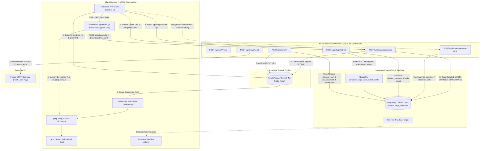

# System Architecture & Technical Specifications

## 1. High-Level Architecture Overview



---

## 2. Monorepo Structure (`Turborepo` with `pnpm`)

The repository adheres to industrial monorepo standards:

```
EventPlatformAIClub/
├── .env.example                       # Reference environment variables
├── .gitignore                         # Standard git ignore definitions
├── pnpm-workspace.yaml                # Monorepo workspace definition
├── package.json                       # Root scripts and dev dependencies
├── turbo.json                         # Turborepo task pipeline configuration
├── netlify.toml                       # Netlify deployment configuration
├── PRD.md                             # Product Requirements Document
├── ARCHITECTURE.md                    # Technical Architecture & Data Flows
├── AI_CONTEXT.md                      # Instructions & context for future AI agents
├── packages/
│   ├── db-schema/
│   │   ├── package.json               # Package descriptor for schema
│   │   └── schema.sql                 # Supabase PostgreSQL schema, buckets & RPC functions
│   └── tsconfig/
│       ├── package.json               # Shared TypeScript configurations
│       └── base.json                  # Common compiler options
└── apps/
    └── web/
        ├── package.json               # Next.js 15 app dependencies
        ├── tsconfig.json              # App TypeScript configuration
        ├── next.config.ts             # Next.js configuration
        ├── postcss.config.mjs         # PostCSS configuration
        ├── tailwind.config.ts         # High-contrast cyber dark-theme styling
        └── src/
            ├── app/
            │   ├── globals.css        # Global CSS, scrollbar rules, fonts
            │   ├── layout.tsx         # Root HTML layout & fonts
            │   ├── page.tsx           # Landing page / Magic-link authentication gateway
            │   ├── (admin)/
            │   │   └── admin/
            │   │       └── page.tsx   # 4-Tab Admin Command Center
            │   ├── (arena)/
            │   │   └── arena/
            │   │       └── page.tsx   # Fullscreen Participant Anti-Cheat Arena
            │   └── api/
            │       ├── auth/
            │       │   └── verify/route.ts       # Auth verification endpoint
            │       ├── admin/
            │       │   ├── storage-upload/route.ts # Supabase Storage Signed Upload URL generator
            │       │   ├── s3-upload/route.ts    # Compatibility alias for storage-upload
            │       │   ├── stages/route.ts       # Stage rules & zip_password persistence
            │       │   └── participants/route.ts # Bulk participant importer
            │       ├── brevo/
            │       │   └── send/route.ts         # Pooled SMTP chunked emailer
            │       └── stage/
            │           ├── access-zip/route.ts   # 60s Signed GET URL + timer init
            │           ├── telemetry-ping/route.ts # Silent background telemetry recorder
            │           └── submit/route.ts       # Password verification & speed-run auditor
            ├── components/
            │   ├── arena/
            │   │   ├── AntiCheatWrapper.tsx      # Fullscreen and clipboard lock manager
            │   │   ├── InBrowserIDE.tsx          # Multi-tab in-memory file viewer
            │   │   ├── SheetViewer.tsx           # Multi-sheet Excel/CSV spreadsheet viewer
            │   │   ├── UnlockNextStageModal.tsx  # Next stage ZIP password verification modal
            │   │   ├── ZipPasswordModal.tsx      # Decryption password modal
            │   │   └── LiveLeaderboard.tsx       # Supabase Realtime broadcast drawer
            │   └── admin/
            │       ├── StageBuilderTab.tsx       # Stage configuration & Storage uploader
            │       ├── ParticipantImportTab.tsx  # CSV / Textarea participant generator
            │       ├── BrevoStudioTab.tsx        # Live HTML mailer template designer
            │       └── TelemetryRadarTab.tsx     # Real-time anti-cheat red-flag dashboard
            └── lib/
                ├── storage.ts                    # Supabase Storage Signed URL factory
                ├── s3.ts                         # Backward compatibility re-export
                ├── zip-engine.ts                 # Client in-memory decompression engine
                ├── supabase.ts                   # Anon client & server Admin client
                ├── auth.ts                       # Token & credential validation helpers
                └── types.ts                      # Shared TypeScript data models
```

---

## 3. Detailed Data Flow & Interaction Lifecycle

### 3.1 Stage Access & Supabase Storage Signed URL Flow
1. Participant initiates stage transition or loads Arena.
2. Participant browser invokes `POST /api/stage/access-zip` with payload:
   ```json
   { "accessToken": "AX-1029-4821", "stageNumber": 1 }
   ```
3. Server validates participant token in Supabase.
4. Server inserts a new row into `stage_telemetry`:
   ```sql
   INSERT INTO stage_telemetry (user_id, stage_number, started_at)
   VALUES ($1, $2, NOW())
   ON CONFLICT (user_id, stage_number) DO NOTHING;
   ```
   *Note: Because of `DO NOTHING`, refreshing the page or re-fetching the signed URL never resets the started timer.*
5. Server signs a 60-second Supabase Storage Signed `GET` URL for the stage's `storage_path`:
   ```ts
   const { data } = await supabaseAdmin.storage
     .from('stages')
     .createSignedUrl(stage.storage_path, 60);
   ```
6. Server returns stage configuration to the client:
   ```json
   {
     "downloadUrl": "https://your-project.supabase.co/storage/v1/object/sign/stages/...",
     "allowedCopyFilename": "ai_prompt.txt",
     "isPasswordProtected": true,
     "hasPassword": true
   }
   ```
7. Browser fetches the binary `ArrayBuffer` directly from Supabase Storage CDN, bypassing Netlify entirely.
8. `@zip.js/zip.js` extracts file entries in RAM. If password-protected, the UI captures the password exception and requests the key via `ZipPasswordModal.tsx`.

---

### 3.2 Stage Progression via Next Stage ZIP Password Decryption
1. Participants inspect files within Stage $N$ to deduce the password for Stage $N+1$'s archive.
2. Clicking **"Unlock Next Stage"** opens `UnlockNextStageModal.tsx`.
3. The modal requests Stage $N+1$'s signed download URL from `POST /api/stage/access-zip`.
4. The client downloads Stage $N+1$'s archive into a memory `Blob` and tests client-side extraction using `@zip.js/zip.js` with the entered password.
5. If extraction fails, the modal displays:
   `"Wrong password, try to figure it out once again."`
   The user remains on Stage $N$ without disruption.
6. If extraction succeeds, the modal invokes `POST /api/stage/submit` with:
   ```json
   {
     "accessToken": "AX-...",
     "stageNumber": 1,
     "nextStagePassword": "discovered_password"
   }
   ```
7. The server:
   - Validates `nextStagePassword` against `stages.zip_password`.
   - Computes $\text{duration\_seconds} = \text{floor}(\text{NOW}() - \text{started\_at})$.
   - If $\text{duration\_seconds} < \text{stage.min\_expected\_seconds}$, sets `flagged_too_fast = true` and `flag_reason`.
   - Calls atomic RPC `complete_stage_and_award_points` to update user score and unlock Stage $N+1$.
   - Returns success payload to the client, triggering celebratory confetti and opening Stage $N+1$.

---

### 3.3 Anti-Cheat Telemetry & Speed-Run Auditing
- When the participant exits fullscreen or switches browser tabs:
  - `document.onvisibilitychange` or `document.onfullscreenchange` triggers.
  - A silent non-blocking request is fired to `/api/stage/telemetry-ping`:
    ```json
    { "accessToken": "...", "stageNumber": 1, "type": "fullscreen_exit" }
    ```
  - The server updates `stage_telemetry` via SQL increment:
    ```sql
    UPDATE stage_telemetry
    SET fullscreen_exits = fullscreen_exits + 1
    WHERE user_id = $1 AND stage_number = $2;
    ```
- When unlocking the next stage (`POST /api/stage/submit`):
  - Server verifies `nextStagePassword`.
  - Server queries `stage_telemetry` for `started_at` timestamp.
  - If duration is below threshold, the user is flagged silently in `stage_telemetry` and `users.is_flagged = true`.
  - The user advances smoothly, preventing detection algorithm reverse-engineering.

---

### 3.4 Atomic RPC Stage Progression
To eliminate race conditions across 200 concurrent users, stage progression and score updates are governed by an atomic PostgreSQL RPC function:

```sql
CREATE OR REPLACE FUNCTION complete_stage_and_award_points(
    p_user_id UUID,
    p_stage_number INT,
    p_points INT,
    p_is_flagged BOOLEAN
)
RETURNS VOID
LANGUAGE plpgsql
SECURITY DEFINER
AS $$
BEGIN
    UPDATE users
    SET 
        total_score = total_score + p_points,
        current_stage = GREATEST(current_stage, p_stage_number + 1),
        is_flagged = is_flagged OR p_is_flagged
    WHERE id = p_user_id;

    UPDATE stage_telemetry
    SET
        completed_at = NOW(),
        duration_seconds = EXTRACT(EPOCH FROM (NOW() - started_at))::INT
    WHERE user_id = p_user_id AND stage_number = p_stage_number;
END;
$$;
```

---

### 3.5 Pooled SMTP Bulk Email Engine
Netlify serverless functions have a hard 10-second ceiling. Standard sequential SMTP sending would exceed timeout after ~10 recipients.
To deliver emails to 150–200 participants within the Netlify limit:
1. `nodemailer` is configured with `pool: true` and `maxConnections: 5`.
2. Participant lists are partitioned into chunks of 25.
3. Each chunk runs concurrently via `Promise.allSettled()`.
4. SMTP connections are kept alive across messages, eliminating TLS renegotiation overhead.
